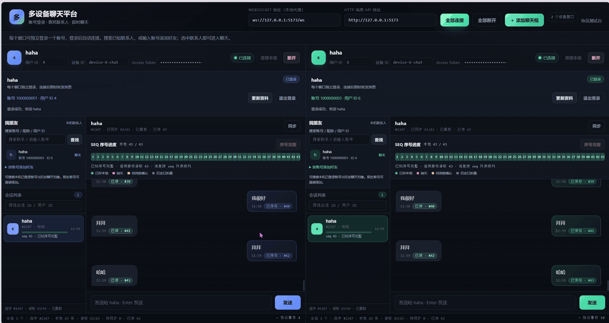
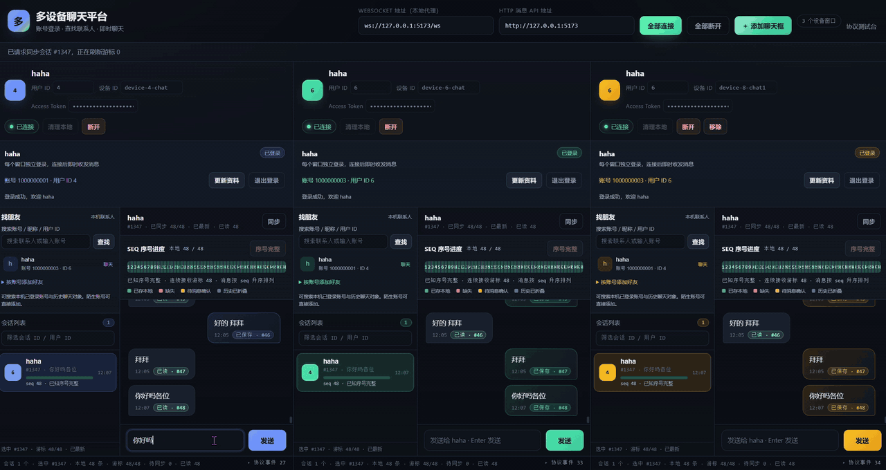
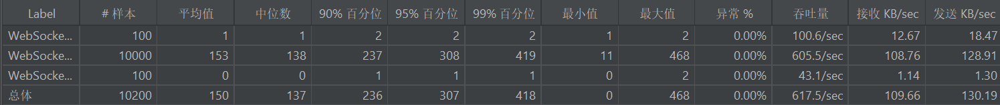
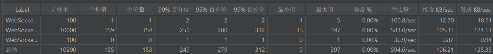
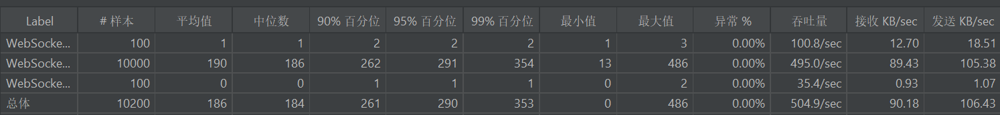
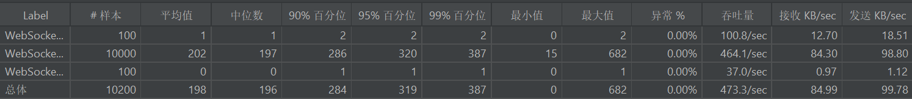

# ChatSystem

基于 Spring Boot、Netty 和 RabbitMQ 的即时通讯后端项目，当前重点实现单聊消息发送、服务端持久化、在线推送与设备离线同步。

## 功能演示

以下 GIF 由 `video/` 中的实际操作录屏生成，可直接在 GitHub 页面循环展示。原始视频保留了更高分辨率，方便查看消息内容和序号变化。

### 一对一单聊

两个账号实时收发消息，展示连续发送、消息气泡局部更新及会话序号变化。



[查看原始视频：一对一单聊](<video/一对一单聊.mp4>)

### 多窗口单聊与数据同步

多个窗口同时展示单聊与同步过程，可观察消息在不同窗口中的更新，以及各会话的 SEQ 进度。本演示为单聊和设备同步，不代表群聊消息链路。



[查看原始视频：一对多单聊、数据同步](<video/一对多单聊，数据同步.mp4>)

## 压测结果

以下为 2026-11-03 记录的 JMeter 聚合报告。测试场景为 **100 个发送者向 100 个不同接收者发送消息，每个发送者发送 100 条，共 10,000 条消息**。

| 指标 | 最新一轮结果 |
| --- | ---: |
| 消息提交吞吐 | 605.5 条/秒 |
| 平均提交确认耗时 | 153 ms |
| P95 提交确认耗时 | 308 ms |
| P99 提交确认耗时 | 419 ms |
| 发送采样错误率 | 0.00% |

### 最新一轮压测截图



<details>
<summary>展开查看其他三轮压测截图</summary>

**复测一**



**复测二**



**复测三**



</details>

指标取 10,000 个消息样本对应的采样器行，采样结束点为 `SAVED_ACK`，表示消息提交至 Outbox 后的确认，**不等于消息最终落库或接收设备送达耗时**。上述数值是该环境下的单轮观测，不作为系统容量上限。测试条件、其他轮次结果和统计口径见[单聊消息压测报告](docs/单聊消息压测报告.md)。

## 功能概览

- 用户注册、登录、令牌刷新及好友申请/验证。
- 基于 Netty WebSocket 的实时连接，连接入口为 `/ws`。
- 单聊消息按会话分配 `seq`，以 `clientMessageId` 支持发送幂等。
- 消息 Outbox、RabbitMQ 发布确认和定时扫描补偿。
- Redis 用于在线关系、好友关系缓存和会话序号等快速访问数据。
- 设备同步游标、离线补拉、连续序号确认（`DELIVERY_ACK`）和已读确认（`READ_ACK`）。
- 群组服务提供群组及成员相关接口；端到端群聊消息链路需以当前实现和测试为准，本项目现阶段的主要验证范围是单聊。
- JMeter 测试计划位于 `ChatSystem/jmeter/测试计划.jmx`，测试记录位于 `ChatSystem/jmeter/压测记录文档.md`。

消息状态的含义需要区分：`SAVED_ACK` 表示服务端已接受保存请求；Outbox 的 `SENT` 表示 RabbitMQ 发布确认成功；两者都不代表接收设备已保存消息。设备游标应在客户端保存连续消息后，通过 `DELIVERY_ACK` 推进。

## 技术栈

- JDK 17、Maven
- Spring Boot 3.5.x、Spring Cloud、Spring Cloud Alibaba
- Netty、WebSocket、OpenFeign
- MySQL、MyBatis-Plus、Redis
- RabbitMQ、Nacos、Seata
- JMeter（压测）

## 模块结构

| 模块 | 职责 |
| --- | --- |
| `chat-gateway` | HTTP API 网关、服务发现与路由 |
| `chat-user` | 用户、认证、好友关系 |
| `chat-group` | 群组和成员管理 |
| `chat-message` | 消息、会话、Outbox、设备同步游标及 HTTP 接口 |
| `chat-connection` | Netty WebSocket 连接、实时收发、RabbitMQ 消费和 Outbox 扫描 |
| `chat-common` | 公共实体、DTO、常量及通用代码 |
| `chat-api` | 微服务间 Feign API |

## 环境要求

- JDK 17
- Maven 3.8 或更高版本
- MySQL 8
- Redis
- RabbitMQ（应用使用 `/chat` virtual host）
- Nacos
- Seata Server（当前服务配置指向 `${chat.ns.host}:8099`）

用户、消息和群组服务分别连接 `user_server`、`message_server`、`group_server` 数据库。建表脚本位于 [database/database.sql](database/database.sql)，启动前请核对脚本与当前实体、Mapper 的表结构是否一致。

## 配置

服务默认配置位于各模块的 `src/main/resources/application.yaml`，本地配置位于 `application-local.yaml`。启动前检查并配置以下连接信息：

| 配置项 | 用途 |
| --- | --- |
| `chat.db.host`、`chat.db.post`、`chat.db.pw` | MySQL 地址、端口和密码 |
| `chat.rd.host`、`chat.rd.post`、`chat.rd.db`、`chat.rd.pw` | Redis 连接 |
| `chat.mq.host`、`chat.mq.port`、`chat.mq.un`、`chat.mq.ps` | RabbitMQ 连接 |
| `chat.ns.host` | Nacos 地址，也用于当前 Seata Server 地址配置 |

不要将个人环境中的数据库或中间件凭证提交到版本库。可在本地 profile 配置中填入自己的环境值，或通过 Spring Boot 命令行参数/环境变量覆盖配置。

## 构建

从仓库根目录进入 Maven 聚合项目后构建：

```powershell
cd ChatSystem
mvn -DskipTests package
```

构建单个服务及其模块依赖，例如：

```powershell
mvn -pl chat-message -am package -DskipTests
```

## 本地启动

先启动并确认 MySQL、Redis、RabbitMQ、Nacos 和 Seata Server 可用，再按以下顺序启动服务：

1. `chat-user`、`chat-group`、`chat-message`
2. `chat-gateway`
3. `chat-connection`

可以在 IDE 中分别运行各模块的 Spring Boot 启动类，并启用 `local` profile。也可以先构建，再在 PowerShell 的不同终端进入 `ChatSystem` 目录运行：

```powershell
java -jar chat-user/target/chat-user-1.0-SNAPSHOT.jar --spring.profiles.active=local
java -jar chat-group/target/chat-group-1.0-SNAPSHOT.jar --spring.profiles.active=local
java -jar chat-message/target/chat-message-1.0-SNAPSHOT.jar --spring.profiles.active=local
java -jar chat-gateway/target/chat-gateway-1.0-SNAPSHOT.jar --spring.profiles.active=local
java -jar chat-connection/target/chat-connection-1.0-SNAPSHOT.jar --spring.profiles.active=local
```

当前 HTTP 服务端口：

| 服务 | 地址 |
| --- | --- |
| 网关 | `http://localhost:8080` |
| 用户服务 | `http://localhost:8081` |
| 群组服务 | `http://localhost:8082` |
| 消息服务 | `http://localhost:8083` |
| WebSocket | `ws://localhost:9000/ws` |

网关当前配置了 `/user/**`、`/friend/**`、`/group/**`、`/sync/**` 和 `/ws/**` 路由。消息服务的同步、确认等接口定义在 `chat-message` 模块中；请使用下方协议文档和控制器实现核对具体参数。

## 单聊消息流程

```text
客户端 CHAT
    -> WebSocket 连接服务
    -> 消息服务保存 Outbox 并返回 SAVED_ACK
    -> 后台任务持久化 message、推进 conversation
    -> 发布 RabbitMQ 在线推送事件
    -> 发布确认后更新 Outbox 状态
    -> 客户端保存连续消息后发送 DELIVERY_ACK
    -> 设备同步游标单调推进
```

用户离线时，消息仍保存在消息表；设备重连后按会话同步游标拉取缺失消息。MQ 发布确认、WebSocket 写出和客户端持久化确认是不同阶段，不能将它们视为同一个“已送达”状态。

## 文档和测试

- [连接与消息同步协议](docs/连接文档.md)：WebSocket 帧、`SAVED_ACK`、同步请求、设备游标和 ACK 约定。
- [单聊消息压测报告](docs/单聊消息压测报告.md)：压测条件、结果和限制说明。
- [产品需求说明书](docs/产品需求说明书.md)
- [开发技术选型说明](docs/开发技术选型说明.md)
- [JMeter 测试计划](ChatSystem/jmeter/测试计划.jmx)

运行 JMeter 前，需要先准备测试账号、好友关系、数据库和中间件，并检查测试计划中的 CSV 数据、目标地址及线程配置。压测结果只适用于报告记录的环境和测试条件。

## 当前范围说明

该仓库仍处于开发和验证阶段。README 描述的是代码中可见的模块和协议，不等同于生产部署说明；上线前还需完成配置密钥管理、数据库迁移、服务故障恢复、多实例路由、客户端完整性验证和持续负载测试。
