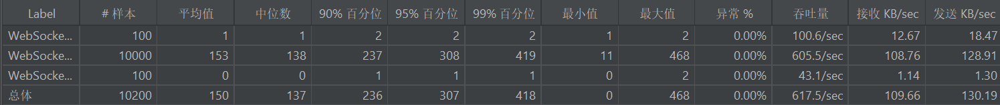
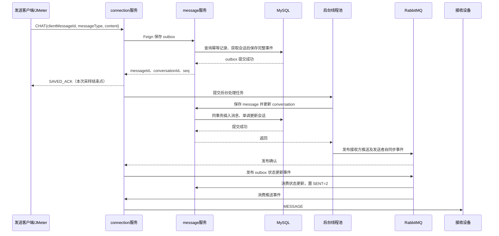
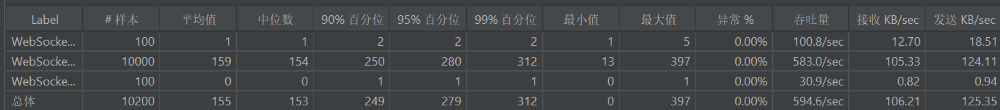
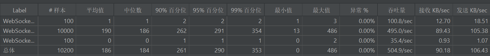
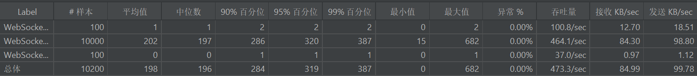

# ChatSystem 单聊消息压测报告与执行指南

记录日期：2026-11-03（Asia/Shanghai）  
测试执行：项目开发者手动执行 JMeter 并核对数据  
结果依据：实际测试截图、项目配置、`PERF_*` 抽样日志及开发者的一致性核验反馈

## 1. 测试结论与指标口径

在 100 个发送者向 100 个不同接收者发送消息、每个发送者发送 100 条、合计 10,000 条消息的场景下，最新一轮结果如下：

| 指标 | 最新一轮结果 |
|---|---:|
| 发送消息样本数 | 10,000 |
| 消息提交吞吐 | **605.5 条/秒** |
| 平均确认耗时 | **153ms** |
| 中位数 | 138ms |
| P90 | 237ms |
| P95 | 308ms |
| P99 | 419ms |
| 最小 / 最大耗时 | 11ms / 468ms |
| 发送采样错误率 | **0.00%** |
| 数据一致性 | 开发者反馈：本轮数据库数据及序号核对一致 |



统计取截图中 **10,000 个样本的 WebSocket request-response Sampler 行**。总体行包含建立连接、关闭连接等样本，最新截图总体吞吐为 617.5 次/秒，不能写成消息吞吐。

当前请求响应采样结束于收到并通过类型断言的 `SAVED_ACK`。其含义是完整消息已保存到 outbox，后台继续保存 message、推进会话并投递。因此：

- 提交确认耗时不等于 message 表最终落库耗时，也不等于设备接收耗时。
- outbox 的 `SENT / 2` 表示推送 MQ 的发布确认成功，不代表设备已经保存消息。
- 本轮数据一致性由开发者核验，本文未附原始 SQL 导出；后续按第 7 节归档核验结果。
- 605.5 条/秒是当前环境、当前负载下的单轮观测结果，尚未通过阶梯加压确定系统容量上限。

## 2. 测试环境与配置

### 2.1 已确认配置

| 项目 | 配置 / 来源 |
|---|---|
| 项目 | `E:\Project\five\ChatSystem` |
| 测试计划 | `ChatSystem/jmeter/测试计划.jmx` |
| JMeter | 计划文件声明版本 5.6.3 |
| WebSocket 插件 | 使用 `eu.luminis.jmeter.wssampler.*` 采样器；实际插件版本待记录 |
| Java / Spring Boot | 项目编译目标 Java 17；Spring Boot 3.5.10 |
| WebSocket 地址 | `ws://127.0.0.1:9000/ws` |
| 消息模式 | 100 对独立单聊会话，文本消息 |
| 请求业务线程池 | core=64，max=150，queueCapacity=1000 |
| 后台 outbox 线程池 | core=64，max=150，queueCapacity=1000 |
| 两个线程池拒绝策略 | `CallerRunsPolicy` |
| message 服务 HikariCP | maximumPoolSize=20，minimumIdle=10 |
| connection 服务 RabbitMQ 监听器 | concurrency=10，maxConcurrency=50，prefetch=50 |
| message 服务 RabbitMQ 监听器 | concurrency=5，maxConcurrency=10，prefetch=20 |
| 性能日志 | 按 `clientMessageId` 哈希约 1% 抽样，两个服务采用相同抽样条件 |

以上为文档编写时仓库配置，实际运行配置可能被启动参数或 profile 覆盖，每轮测试应保存配置快照。

### 2.2 需要随测试记录的环境信息

| 项目 | 本次记录情况 |
|---|---|
| CPU 型号 / 核数、物理内存 | 待补充 |
| MySQL / Redis / RabbitMQ 服务端版本 | 待补充；项目 JDBC 驱动版本不能代替 MySQL 服务端版本 |
| 应用与中间件部署位置 | JMeter 连接本机 WebSocket；其余部署拓扑待补充 |
| 虚拟机 CPU / 内存 / 磁盘配置 | 如使用虚拟机，需补充 |
| 运行时 JDK 版本、JVM 堆配置 | 待补充；与项目编译目标分别记录 |
| JMeter 启动方式、堆配置 | 待补充；已有结果来自 GUI 聚合报告截图 |
| 测试前 message / outbox 行数 | 待补充，每轮记录基线 |
| 测试时 CPU、GC、数据库连接等待、磁盘 I/O | 尚未完整采集 |

历史文件 `ChatSystem/jmeter/压测记录文档.md` 中的 Java 1.8、多人发送给同一人等描述属于早期记录，不套用到本轮测试。

### 2.3 日志输出配置

文档编写时，两个服务都关闭了控制台输出，但文件输出方式不同：

| 服务 | 实际文件输出配置 |
|---|---|
| chat-connection | AsyncAppender 包装 DAILY_FILE，queueSize=1024，discardingThreshold=0，neverBlock=false |
| chat-message | root 直接引用 DAILY_FILE，仍为同步文件输出 |

日志路径：

```text
E:\Project\five\logs\chat-connection\daily\daily.log
E:\Project\five\logs\chat-message\daily\daily.log
```

异步日志队列满时，当前配置会阻塞日志调用线程。每轮记录日志方式及级别，避免配置差异影响横向比较。性能测试保留抽样 `PERF_*`、WARN、ERROR，逐条消息事件日志可降为 DEBUG。以上为后续测试建议，本报告未修改日志配置。

## 3. 消息处理链路



状态更新与设备推送由独立消费者处理，彼此没有固定完成先后顺序。

## 4. JMeter 测试计划

### 4.1 用户与会话数据

使用 `ChatSystem/jmeter/pairs.csv`，表头为 `userId,toId`，共 100 行数据：

```csv
userId,toId
1008,1108
1009,1109
...
1107,1207
```

发送者范围为 1008～1107，接收者范围为 1108～1207。测试前保证对应关系已经成为好友，Redis 好友缓存与账号状态正确。

两个线程组各自配置 CSV Data Set：

| 参数 | 当前值 |
|---|---|
| variableNames | userId,toId |
| ignoreFirstLine | true |
| recycle | false |
| stopThread | true |
| shareMode | 当前线程组共享 |

两个组分别消费同一份配对文件。增加到 200 对时，需要同时扩充 CSV、好友数据和发送/接收线程数；只增加线程数，额外线程可能因 CSV EOF 退出。

### 4.2 发送者线程组

| 参数 | 当前值 |
|---|---|
| 线程数 | 100 |
| Ramp-up | 1 秒 |
| 每线程发送次数 | 内层循环 100 次 |
| 发送总数 | 10,000 |
| 连接路径 | `/ws?userId=${userId}&deviceId=jmeter-${userId}` |
| 连接超时 / 请求读取超时 | 20,000ms / 6,000ms |
| 控制帧过滤 | CONNECTION_READY、SYNC_SUMMARY |
| 响应断言 | `$.type` 匹配 SAVED_ACK |

当前计划中的请求如下，`messageType` 在文件中仍为字符串 `"1"`：

```json
{
  "type": "CHAT",
  "to": ${toId},
  "clientMessageId": "msg-${userId}-${__UUID()}",
  "payload": {
    "messageType": "1",
    "content": "jmeter-${__UUID()}"
  }
}
```

后续统一协议时建议改为数字 `1`，单独记录变更。重试同一条消息时复用首次生成的 `clientMessageId`，不要重新计算 UUID。

当前计划只断言响应类型，没有断言响应 `clientMessageId` 与当前请求一致。需要严格关联时，应在发送前生成并保存 ID，再断言响应 ID；本文不把该能力写成已完成。

### 4.3 接收者线程组与测试范围

接收者线程数 100，连接路径为 `/ws?userId=${toId}&deviceId=jmeter-${toId}`，每线程执行 100 次 Single Read。

当前计划存在以下范围限制：

- 两个线程组并行启动，没有“所有接收者已就绪后再发送”的屏障，因此不是严格的全员在线推送基准。
- 接收组未配置 MESSAGE 类型断言和控制帧过滤，100 次读取不能直接等价为 100 条业务消息。
- 接收组没有发送 DELIVERY_ACK，也没有本地持久化和连续 seq 检查。
- 发送组下的聚合报告只统计其作用域样本，截图中的 10,200 个样本不能作为所有设备收齐的证据。

本报告将已验证范围限定为发送提交性能及开发者核对的落库一致性。完整设备收取、已读、离线补拉、故障恢复另设场景。

## 5. 可重复执行步骤

1. 保存本轮代码提交、运行配置、环境信息和测试前数据基线。
2. 确认测试账号、好友和 CSV 数据完整；服务与中间件正常，历史 MQ 积压及后台任务已经处理完。
3. 如需预热，使用独立轮次标识执行预热，记录预热数量；预热不计入正式结果。
4. 保存 JMeter 计划，清空 GUI 旧结果；正式性能测试建议使用非 GUI 模式，并停用查看结果树等高开销监听器。
5. 记录起止时间，执行 100 × 100 发送场景，同时采集应用、数据库及 MQ 指标。
6. 请求采样结束后继续观察后台。以本轮 outbox 状态收敛、线程池队列排空、MQ ready/unacked 收敛为准，不用固定等待 8 秒代替判定。
7. 执行第 7 节的数据核验，保存 SQL 导出及 Redis 对照结果。
8. 保存 JTL、报告、日志切片、截图与配置快照。保持参数不变重复至少 3 轮，再进行下一项调优。

非 GUI 命令模板（按实际安装路径修改，在本机手动执行）：

```powershell
$jmeterBat = 'C:\Tools\apache-jmeter-5.6.3\bin\jmeter.bat'
$runFolder = 'E:\Project\five\ChatSystem\jmeter\results\20261103-run01'
New-Item -ItemType Directory -Path $runFolder -Force | Out-Null
& $jmeterBat -n `
  -t 'E:\Project\five\ChatSystem\jmeter\测试计划.jmx' `
  -l "$runFolder\samples.jtl" `
  -j "$runFolder\jmeter.log" `
  -e -o "$runFolder\html"
```

每轮使用新目录，HTML 目标目录须为空或不存在。WebSocket 插件需安装在实际运行 JMeter 的环境中；测试地址和 CSV 路径当前写在计划内，启动参数不会自动替换它们。

## 6. 性能日志与调优过程

### 6.1 抽样指标含义

| 日志标签 | 测量范围 |
|---|---|
| PERF_QUEUE.queueMs | 提交业务线程池到任务开始执行 |
| PERF_QUEUE.taskMs | 任务开始到处理方法结束；不代表客户端网络收包完成 |
| PERF_FEIGN | `msgClient.saveMsg(...)` 调用总耗时 |
| PERF_QUERY | message 去重查询调用 |
| PERF_ROUTE | 获取会话、缓存回查、Redis 操作、seq 与 messageId 分配 |
| PERF_OUTBOX_SAVE | outbox 保存调用，可能包含连接等待、执行与提交 |

按同一轮的 `clientMessageId` 关联五类日志。Feign 已包含服务端几个阶段，统计时不能重复相加。失败或提前返回的请求可能没有所有阶段日志；抽样均值也不等于 JMeter 全量均值。约 100 条抽样适合定位平均开销，P99 使用完整 JTL 统计。

### 6.2 代表性观测

下表是历史日志中的抽样平均耗时，单位 ms。每次对比都需结合配置变化；多项同时调整时不能把收益单独归因于其中一项。

| 场景 | 完整样本 | 排队 | Feign | 去重查询 | outbox 保存 |
|---|---:|---:|---:|---:|---:|
| 14:58，业务/后台32线程，默认10连接 | 107 | 202.2 | 91.2 | 37.3 | 50.5 |
| 15:07，业务/后台64线程，10连接 | 94 | 93.8 | 178.2 | 79.5 | 86.2 |
| 15:08，业务/后台64线程，10连接 | 105 | 90.8 | 174.8 | 77.5 | 94.2 |
| 15:08～15:09，业务/后台64线程，10连接 | 91 | 103.2 | 189.4 | 86.4 | 100.0 |
| 15:17～15:18，业务/后台64线程，20连接 | 99 | 103.2 | 82.4 | 27.3 | 34.9 |
| 15:22 第一轮，64线程，20连接 | 85 | 105.7 | 49.4 | 16.0 | 29.7 |
| 15:22～15:23 第二轮，64线程，20连接 | 100 | 68.7 | 126.7 | 51.8 | 70.9 |
| 15:23 第三轮，64线程，20连接 | 75 | 70.2 | 120.8 | 48.8 | 68.2 |

观察与解释：

1. 32 个业务线程经常全部忙碌，队列未达到容量1000，`maxPoolSize=150` 没有触发扩容。
2. 两个线程池同时提高到64后，排队减少，但数据库相关调用变慢，单纯增加线程收益有限。
3. HikariCP 最大连接数从10提高到20后，查询及保存调用明显改善，支持连接池容量此前构成重要限制的判断。
4. 尚未直接拆分获取连接、SQL执行及提交耗时，不能把所有慢调用都归因于连接等待。
5. 同一配置仍有跨轮波动，需要继续采集 Hikari active/idle/pending、MySQL锁等待和磁盘I/O、JVM GC及MQ积压。

### 6.3 20连接配置下的重复测试结果

各行均为 10,000 条发送采样，错误率均为0%；前四轮展示最新最佳轮次之前的观测。

| 轮次 | 吞吐，条/秒 | 平均，ms | P95，ms | P99，ms | 最大，ms |
|---|---:|---:|---:|---:|---:|
| 扩容后首次 | 555.3 | 171 | 349 | 569 | 1485 |
| 重复第一轮 | 583.0 | 159 | 280 | 312 | 397 |
| 重复第二轮 | 495.0 | 190 | 291 | 354 | 486 |
| 重复第三轮 | 464.1 | 202 | 320 | 387 | 682 |
| 最新一轮 | **605.5** | **153** | **308** | **419** | **468** |

已有观测范围约为464～606条/秒。最新一轮为当前观测中的最高吞吐，不表述为持续稳定605条/秒。

重复测试截图：







## 7. 数据一致性核验

### 7.1 核验范围与基线

本轮应新增10,000条消息、涉及100个会话、每会话新增100条。已有会话的 `last_seq` 应相对测试前增加100，而不是要求最终值必须为100。

记录测试前每个目标会话的 `last_seq`、message条数、Redis `chat:seq:{conversationId}`，保存为CSV。运行结束且后台处理完成后，在没有新写入干扰的情况下比较增量。

建议后续在 JMeter 用户定义变量增加 `runPrefix`，例如 `run-20261103-01-`，客户端消息ID改为：

```text
${runPrefix}${userId}-${__UUID()}
```

以下SQL适用于采用该轮次前缀的后续测试。已有历史消息使用 `msg-用户-UUID`，不能直接代入此前缀查询；应使用本轮请求ID清单，或结合发送者、起止时间及测试前后基线筛选。时间字段精度和异步写入会影响边界，不建议只靠精确到秒的时间条件。

所有SQL只读取业务表，`SET` 仅定义当前SQL会话变量；本文未执行这些SQL。

### 7.2 消息总量与每会话seq连续性

```sql
SET @run_prefix = 'run-20261103-01-';

-- 预期：message_count=10000，conversation_count=100，sender_count=100。
SELECT COUNT(*) AS message_count,
       COUNT(DISTINCT conversation_id) AS conversation_count,
       COUNT(DISTINCT sender_id) AS sender_count
FROM message
WHERE client_message_id LIKE CONCAT(@run_prefix, '%');

-- 预期返回0行。配合上面的总会话数检查，避免遗漏整个会话。
SELECT conversation_id,
       COUNT(*) AS message_count,
       COUNT(DISTINCT seq) AS unique_seq_count,
       MIN(seq) AS min_seq,
       MAX(seq) AS max_seq
FROM message
WHERE client_message_id LIKE CONCAT(@run_prefix, '%')
GROUP BY conversation_id
HAVING COUNT(*) <> 100
    OR COUNT(DISTINCT seq) <> 100
    OR MAX(seq) - MIN(seq) + 1 <> 100;

-- 预期返回0行。
SELECT sender_id, client_message_id, COUNT(*) AS duplicate_count
FROM message
WHERE client_message_id LIKE CONCAT(@run_prefix, '%')
GROUP BY sender_id, client_message_id
HAVING COUNT(*) > 1;
```

单轮内部连续还不足以证明与上一轮无断点：对每会话额外检查 `本轮MIN(seq)=基线last_seq+1`、`本轮MAX(seq)=基线last_seq+100`。以上条件以测试期间没有其他写入、没有删除数据为前提。

### 7.3 会话最后消息信息

```sql
-- 检查本轮涉及会话的当前 last_seq 与全部已落库消息最大seq是否一致。
WITH target_conversations AS (
    SELECT DISTINCT conversation_id
    FROM message
    WHERE client_message_id LIKE CONCAT(@run_prefix, '%')
), maxima AS (
    SELECT m.conversation_id, MAX(m.seq) AS max_seq
    FROM message m
    JOIN target_conversations t ON t.conversation_id = m.conversation_id
    GROUP BY m.conversation_id
)
SELECT c.id AS conversation_id, c.last_seq, x.max_seq,
       c.last_message_id, last_msg.id AS expected_last_message_id
FROM maxima x
LEFT JOIN conversation c ON c.id = x.conversation_id
LEFT JOIN message last_msg
       ON last_msg.conversation_id = x.conversation_id
      AND last_msg.seq = x.max_seq
WHERE c.id IS NULL
   OR NOT (c.last_seq <=> x.max_seq)
   OR NOT (c.last_message_id <=> last_msg.id);
```

预期返回0行。存在防回退条件时，旧seq晚于新seq更新可能影响0行；日志里的“会话更新失败/防回退”提示本身不能作为数据错误结论，最终以核验结果为准。

### 7.4 outbox与message对应及最终状态

```sql
-- 本轮outbox数量预期10000，最终全部status=2。
SELECT status, COUNT(*) AS outbox_count
FROM message_outbox
WHERE event_type = 'MESSAGE_CREATE'
  AND event_key LIKE CONCAT('message:%:', @run_prefix, '%:create')
GROUP BY status;

-- 检查outbox指向不存在的消息，或会话/seq不一致；预期返回0行。
SELECT o.id AS outbox_id, o.message_id, o.conversation_id, o.seq,
       m.conversation_id AS message_conversation_id, m.seq AS message_seq
FROM message_outbox o
LEFT JOIN message m ON m.id = o.message_id
WHERE o.event_type = 'MESSAGE_CREATE'
  AND o.event_key LIKE CONCAT('message:%:', @run_prefix, '%:create')
  AND (m.id IS NULL
       OR NOT (o.conversation_id <=> m.conversation_id)
       OR NOT (o.seq <=> m.seq)
       OR NOT (o.event_key <=> CONCAT('message:', m.sender_id, ':',
                                     m.client_message_id, ':create')));

-- 反向检查message是否缺少对应outbox；预期返回0行。
SELECT m.id AS message_id, m.conversation_id, m.seq
FROM message m
LEFT JOIN message_outbox o
       ON o.message_id = m.id AND o.event_type = 'MESSAGE_CREATE'
WHERE m.client_message_id LIKE CONCAT(@run_prefix, '%')
  AND o.id IS NULL;
```

状态0为待处理，历史1按待处理兼容，3为待重试，4为最终失败。状态2是MQ发布成功。消息总量、outbox总量和双向关联需一起检查，避免仅检查已有记录而漏掉未落库请求。

### 7.5 Redis对照与结果归档

读取本轮100个会话的 `chat:seq:{conversationId}`，与 `conversation.last_seq`、`MAX(message.seq)` 对照。停止新写入并等待后台完成后，本正常无失败场景预期三者相等；不要通过手工回退Redis值来修饰测试结果。

Redis INCR和MySQL写入不是原子操作；异常情况下分配seq后失败可能产生空洞，这需要单独测试与处理，不能凭本轮正常结果宣称所有故障下均无空洞。

建议每轮保存：

```text
results/轮次目录/
  environment.md          # 硬件、版本、部署、JVM和配置
  samples.jtl
  jmeter.log
  html/
  sender-summary.png
  baseline.csv            # 测试前各会话数据
  message-check.csv
  conversation-check.csv
  outbox-check.csv
  redis-check.csv
  connection-perf.log
  message-perf.log
```

## 8. 后续待验证场景

以下列为后续计划，未作为本轮已完成结论：

| 场景 | 操作 | 核验目标 |
|---|---|---|
| 重复请求 | 同一发送者反复提交同一clientMessageId | 返回原messageId/seq；消息只保存一次；不同内容不得误复用 |
| ACK丢失后重发 | 保存成功但客户端未收到SAVED_ACK后重试 | 复用原请求，不生成第二条业务消息 |
| 服务重启 | outbox提交后、message提交前中断服务 | 启动后能够恢复任务，无永久遗漏 |
| MQ异常 | 发布期间模拟不可用再恢复 | 重试状态可观察，恢复后继续投递，不错误标记成功 |
| 离线设备 | 离线期间发送，上线后同步 | 按设备游标补拉完整消息 |
| 消息乱序 | 连续游标24时先收到28 | 本地保留28，补齐25～27后才能确认28 |
| 设备确认 | 只在本地持久化成功后回复DELIVERY_ACK | 游标单调且不越过未保存的缺口，重复回执不形成循环 |
| 长时间负载 | 固定速率持续30～60分钟 | 吞吐、延迟、内存、连接与队列无持续恶化 |
| 阶梯并发 | 50、100、200等发送者逐档测试 | 配齐账号/好友/CSV，寻找容量拐点 |

当前 `RetryScheduleTask` 的 `@Scheduled` 在源码中仍被注释。验证宕机/扫描补偿前，先确认调度启用、补偿数据还原与并发抢占路径可用；本轮正常负载测试不证明这些故障场景已经通过。

## 9. 对外描述与每轮记录模板

可使用的项目描述：

> 在100个发送者向100个独立单聊会话发送10,000条消息的测试中，单轮消息提交吞吐达到605.5条/秒，平均SAVED_ACK确认延迟153ms、P99为419ms，发送采样错误率0%；测试后核验消息落库、outbox与会话序号一致性。

环境信息补齐后，与该描述一并提供。设备端收齐、持续吞吐、故障恢复分别提供独立验证记录。

后续每轮填写：

| 记录项 | 内容 |
|---|---|
| 轮次 / 起止时间 / runPrefix | |
| 提交版本 / 配置变更 | |
| 冷启动或预热 / 测试前数据量 | |
| 发送线程 / 接收线程 / 每线程消息数 | |
| 业务池 / 后台池 / 数据库最大连接数 | |
| 日志方式 / 日志级别 | |
| 吞吐 / 平均 / P95 / P99 / 最大耗时 / 错误率 | |
| queueMs / Feign / query / route / outbox保存耗时 | |
| Hikari active / idle / pending、CPU / GC / 磁盘 | |
| MQ积压峰值 / 后台收敛时间 | |
| 消息数、会话seq、outbox、Redis核验结果 | |
| 异常说明 / JTL与日志归档位置 | |
