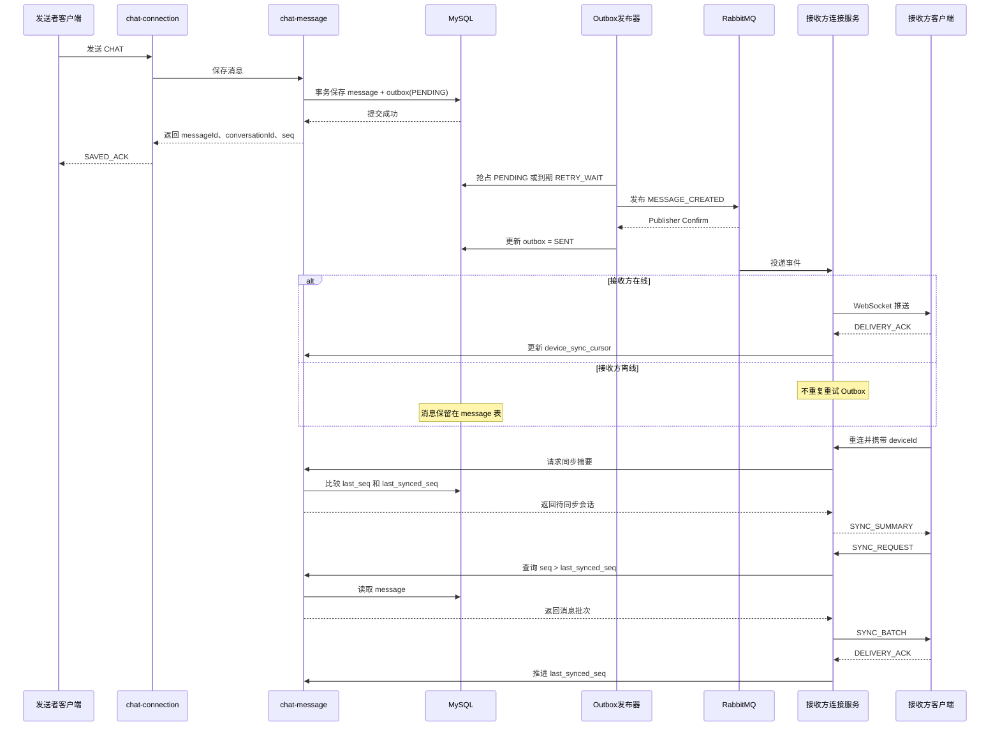

# 连接与消息同步协议（设备游标版）

本文定义单聊场景下的 WebSocket 连接、消息发送、在线推送、离线补拉、接收确认和已读确认协议。

本版本采用设备游标作为消息接收进度的唯一依据：

- `message` 保存业务消息，是消息的唯一来源；
- `conversation.last_seq` 保存会话当前最大序号；
- `message_outbox` 只负责保证消息事件发布到 RabbitMQ；
- `device_sync_cursor.last_synced_seq` 保存某个设备已经确认接收的位置；
- `user_conversation.last_read_seq` 保存用户实际阅读的位置。

本版本不再使用 `off_message_box` 作为新消息的接收进度。用户离线时，消息继续保存在 `message` 表；用户重新上线后，根据设备游标从 `message` 表补拉。

## 一、连接建立

客户端第一次启动时生成一个随机 `deviceId`，并持久化保存。设备重连时必须继续使用同一个 `deviceId`，不能每次建立连接都重新生成。

WebSocket 连接示例：

```text
ws://host:9000/ws?userId=1001&deviceId=设备UUID
```

用户身份应通过登录凭证或连接认证信息确定。客户端传入的 `userId` 不能作为唯一身份依据。

连接认证成功后，连接服务建立临时绑定。一个用户可以同时绑定多个设备，每个设备只保留一个活动通道：

```text
channel -> userId + deviceId
userId + deviceId -> channel
```

该绑定用于在线推送和校验 ACK。连接断开时删除临时绑定，但不能删除数据库中的设备同步游标。

连接成功后，服务端向客户端返回：

```json
{
  "type": "CONNECTION_READY",
  "deviceId": "device-a",
  "serverTime": 1760000000000
}
```

如果设备第一次同步某个会话，服务端创建以下游标记录：

```text
(user_id, device_id, conversation_id)
last_synced_seq = 0
```

## 二、发送单聊消息

客户端发送消息时，不需要传递 `senderId`、`deviceId` 或 `seq`。发送者身份和设备身份从当前 WebSocket 连接中获取，`seq` 由消息服务生成。

文本消息：

```json
{
  "type": "CHAT",
  "toId": 2002,
  "clientMessageId": "client-msg-001",
  "payload": {
    "contentType": "TEXT",
    "content": "你好"
  }
}
```

图片或文件消息：

```json
{
  "type": "CHAT",
  "toId": 2002,
  "clientMessageId": "client-msg-002",
  "payload": {
    "contentType": "FILE",
    "attachmentId": 9001
  }
}
```

`clientMessageId` 由客户端在第一次发送前生成。客户端超时重试时必须保持相同的 `clientMessageId`，服务端根据 `senderId + clientMessageId` 保证幂等。

## 三、服务端保存确认

消息服务在一个数据库事务中完成以下操作：

1. 保存 `message`；
2. 分配会话 `seq`；
3. 更新 `conversation.last_seq`；
4. 保存 `message_outbox`，初始状态为 `PENDING`；
5. 提交事务。

事务提交成功后，连接服务向发送者返回：

```json
{
  "type": "SAVED_ACK",
  "status": "SAVED",
  "clientMessageId": "client-msg-001",
  "messageId": 501,
  "conversationId": 1001,
  "seq": 26,
  "serverTime": 1760000000000
}
```

`SAVED_ACK` 只表示消息已经可靠保存，不表示接收者已经收到，也不表示接收者已经阅读。

如果保存失败，返回：

```json
{
  "type": "SEND_ERROR",
  "clientMessageId": "client-msg-001",
  "code": "MESSAGE_SAVE_FAILED",
  "message": "消息保存失败"
}
```

## 四、Outbox 发布与状态

消息保存成功后，Outbox 发布器异步发布消息事件到 RabbitMQ。Outbox 的业务状态只有以下四种：

| 状态 | 含义 |
|---|---|
| `PENDING` | 消息事件尚未成功发布 |
| `SENT` | RabbitMQ Publisher Confirm 已确认发布成功 |
| `RETRY_WAIT` | 发布失败，等待下一次重试 |
| `FAILED` | 达到最大重试次数，等待人工处理 |

状态流转：

```text
PENDING -> SENT
PENDING -> RETRY_WAIT -> SENT
PENDING -> RETRY_WAIT -> FAILED
```

本版本不使用 `SENDING` 作为业务状态。任务抢占使用 `locked_at` 和 `locked_by` 实现，并通过锁超时恢复异常中断的任务。

`SENT` 的含义仅为：

```text
事件已经被 RabbitMQ 接受
```

`SENT` 不代表：

- 接收服务已经完成业务处理；
- 接收者当前在线；
- WebSocket 已经写入成功；
- 客户端已经收到；
- 用户已经阅读。

## 五、RabbitMQ 事件

发布到 RabbitMQ 的事件必须包含重建消息所需的完整信息：

```json
{
  "metadata": {
    "eventType": "MESSAGE_CREATED",
    "messageId": 501,
    "conversationId": 1001,
    "seq": 26,
    "sendId": 1001,
    "toId": 2002,
    "messageType": 1,
    "timestamp": 1760000000000
  },
  "payload": {
    "content": "你好"
  }
}
```

重复事件必须按照 `eventKey` 或 `messageId` 幂等处理，不能因为 RabbitMQ 重复投递而创建重复业务消息。

## 六、在线推送

连接服务消费消息事件后，根据 `toId` 查找接收者当前在线的设备通道。

如果接收者在线，向其 WebSocket 推送：

```json
{
  "type": "MESSAGE",
  "messageId": 501,
  "conversationId": 1001,
  "seq": 26,
  "sendId": 1001,
  "senderId": 1001,
  "toId": 2002,
  "messageType": 1,
  "payload": {
    "content": "你好"
  }
}
```

接收方客户端收到并完成本地保存后返回：

```json
{
  "type": "DELIVERY_ACK",
  "conversationId": 1001,
  "ackSeq": 26
}
```

服务端根据当前通道绑定的 `userId` 和 `deviceId` 更新该设备的同步游标：

```text
device_sync_cursor.last_synced_seq = max(oldValue, ackSeq)
```

ACK 必须幂等，旧 ACK 不能让游标倒退。

如果消息没有连续收到，客户端不能确认更大的 `ackSeq`。例如只收到 `seq=26` 和 `seq=28` 时，不能直接确认到 `28`。

## 七、用户离线与重新同步

如果 RabbitMQ 事件到达连接服务时，接收者没有在线通道：

1. 不创建重复的业务消息；
2. 不把消息重新写入 `message`；
3. 不因为用户离线而重复重试 Outbox；
4. 消息继续保留在 `message` 表；
5. 用户重新上线后通过设备游标补拉。

用户重新建立连接后，服务端返回各会话待同步摘要：

```json
{
  "type": "SYNC_SUMMARY",
  "conversations": [
    {
      "conversationId": 1001,
      "lastSyncedSeq": 25,
      "lastSeq": 28,
      "pendingCount": 3
    }
  ]
}
```

客户端点击会话后请求同步：

```json
{
  "type": "SYNC_REQUEST",
  "conversationId": 1001,
  "afterSeq": 25,
  "limit": 50,
  "requestId": "sync-001"
}
```

消息服务查询：

```sql
SELECT *
FROM message
WHERE conversation_id = 1001
  AND seq > 25
ORDER BY seq ASC
LIMIT 50;
```

服务端返回：

```json
{
  "type": "SYNC_BATCH",
  "requestId": "sync-001",
  "conversationId": 1001,
  "messages": [
    {
      "messageId": 502,
      "conversationId": 1001,
      "seq": 26,
      "senderId": 1001,
      "messageType": 1,
      "textContent": "你好",
      "attachmentId": null,
      "isRecalled": 0,
      "isBlocked": 0,
      "createdAt": "2026-10-30T12:00:00"
    }
  ],
  "hasMore": true
}
```

客户端完成保存后返回 `DELIVERY_ACK`。服务端成功更新游标后，下一次同步从新的 `last_synced_seq` 继续。

`afterSeq` 只用于兼容客户端的重试请求，服务端不会使用它跳过数据库游标之前的消息；实际查询起点始终是该设备当前的 `last_synced_seq`。

客户端可能因为断线重复收到同一批消息，必须根据 `messageId` 或 `conversationId + seq` 去重。

## 八、已读确认

接收成功不等于已读。用户打开会话并实际阅读到某个位置后，客户端发送：

```json
{
  "type": "READ_ACK",
  "conversationId": 1001,
  "readSeq": 26
}
```

服务端只允许已读位置向前推进：

```text
user_conversation.last_read_seq = max(oldValue, readSeq)
```

`DELIVERY_ACK` 更新设备接收进度，`READ_ACK` 更新用户阅读进度，二者不能混用。

## 九、完整时序



## 十、异常和幂等规则

### 1. 发送者请求超时

客户端使用原来的 `clientMessageId` 重试。服务端返回原消息的 `messageId`、`conversationId` 和 `seq`，不能创建新消息。

### 2. Publisher Confirm 丢失

同一事件可能被再次发布。消费者必须根据 `eventKey` 或 `messageId` 幂等处理。

### 3. 客户端收到消息后断线

如果客户端没有发送 `DELIVERY_ACK`，设备游标不推进。重连后允许再次拉取同一条消息，客户端负责去重。

### 4. ACK 重复或乱序

重复 ACK 不报错；旧 ACK 不能覆盖新的同步位置。

### 5. 设备游标越权

服务端必须校验当前用户是否属于该会话，不能允许客户端更新其他用户或其他会话的游标。

## 十一、协议状态含义

```text
SAVED_ACK      消息已保存
SENT           消息事件已发布到 RabbitMQ
DELIVERY_ACK   设备已收到并保存消息
READ_ACK       用户已阅读消息
```

这四个状态分别属于不同层次，不能互相替代。

## 十二、从离线消息表切换

设备游标方案启用后，新消息不再写入 `off_message_box`。已有 `off_message_box` 中的待处理记录不会自动转换为设备游标，切换前应在测试环境清理，或由一次性迁移任务按用户、会话和消息序号建立初始游标后再启用新流程。
